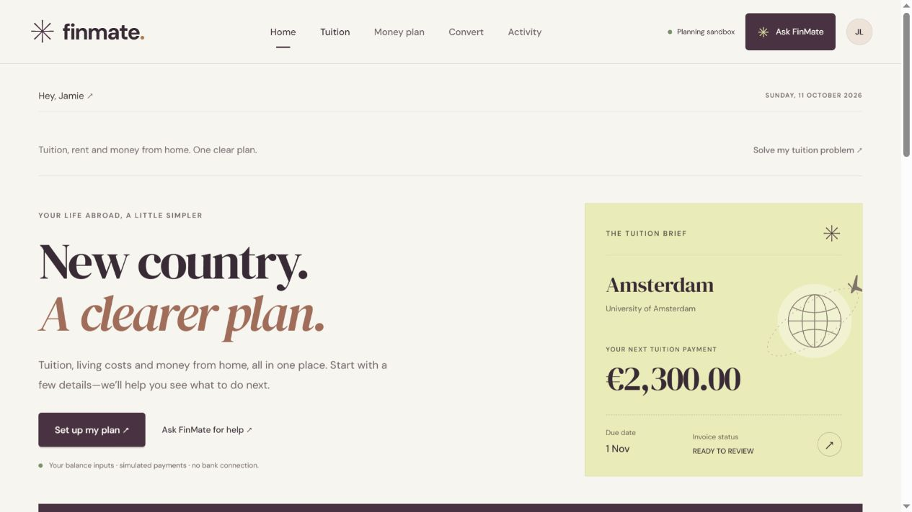

# FinMate

I made FinMate to help international students manage tuition, living costs and money from home.

The student enters their balances, uploads an invoice and asks the agent to work out a plan. FinMate compares the payment options and keeps money aside for living costs. The student reviews the exact payment and confirms it with a PIN.

This version uses simulated accounts. It does not connect to a bank or move real money.



## What it does

- Track EUR, GBP and CNY balances
- Read tuition invoices from PDF, TXT or pasted text
- Compare payment fees and arrival dates
- Combine selected accounts when one balance is not enough
- Check whether a purchase fits the student's budget
- Plan around rent, tuition and expected income
- Explain plans in English or Chinese
- Record approvals and simulated payments in an audit trail

## Technologies I used

For the frontend, I used HTML, CSS and JavaScript.

For the backend, I used Node.js and PDF.js. I used OpenAI for the financial agent and the ECB feed for reference exchange rates.

## Run it

You need Node.js 22.18 or newer.

```bash
npm ci --ignore-scripts
npm run dev
```

Then open http://127.0.0.1:5187.

## API keys

Copy the example file:

```bash
cp .env.example .env
```

On Windows, use `Copy-Item .env.example .env`.

Add your OpenAI key inside `.env` and set `FINMATE_MODEL` to the model you want to use. The offline planner works without a key. It is also used when the model service is unavailable.

I do not keep real API keys or saved accounts inside GitHub. In live mode, chat messages and financial tool results are sent to the configured model provider. Invoice extraction stays local.

## Tests

```bash
npm test
```

The live agent checks are separate and need an API key:

```bash
node tools/evaluate-benchmark.mjs
```

Results and limitations are in [docs/evaluation.md](docs/evaluation.md).

## Important

The AI can read, compare and prepare a payment. It cannot approve a payment, enter the PIN or add money to an account.

Balances are entered by the student and are not verified by a bank. Expected income is not available money until it arrives. Payment fees, rates and delivery estimates are simulated. ECB reference rates are shown separately for information.

Saved accounts are encrypted in `data/`. Keep the storage key if you want to keep using those accounts. This is a local hackathon prototype, not a banking service.

## Competition files

- [Pitch deck](pitch/FinMate.pptx)
- [Architecture](docs/architecture.md)
- [Security](docs/security.md)
- [Evaluation](docs/evaluation.md)
- [Submission checklist](docs/submission.md)

Third-party credits and licenses are in [THIRD_PARTY_NOTICES.md](THIRD_PARTY_NOTICES.md).
